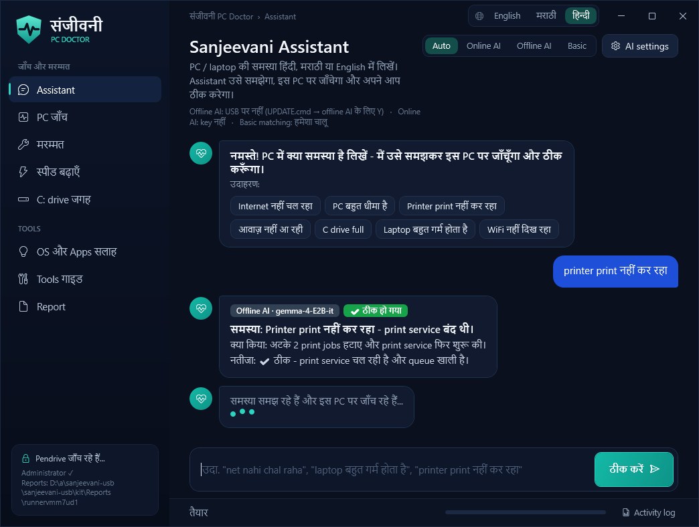

# संजीवनी Rescue USB

*निर्माता : **Mangesh Salvi***

[English](README.md) · [मराठी](README.mr.md) · **हिन्दी**

PC जाँच, मरम्मत और स्पीड बढ़ाने के लिए bootable pendrive. इसमें सिर्फ़ free और legal tools हैं। Pendrive [Ventoy](https://www.ventoy.net) पर आधारित है। User को दिखने वाला सब कुछ **English, मराठी और हिन्दी** में है।

## Pendrive बनाना

1. यह repository download करें (**Code → Download ZIP**) या Actions से `Sanjeevani-USB-Kit` artifact लें, और extract करें।
2. 64 GB pendrive लगाएँ (offline driver packs चाहिए तो 256 GB)। **उसका सारा data मिट जाएगा।**
3. `SETUP.cmd` → Administrator अनुमति → भाषा चुनें → pendrive का Disk number → `ERASE`.
4. बाद में update के लिए pendrive पर `Sanjeevani\Setup\UPDATE.cmd` चलाएँ।
5. **अपने apps:** pendrive के `MyTools` folder में copy करें (portable app का folder, अकेली .exe, installer, या zip / 7z / rar)। वे PC Doctor → Tools गाइड → "मेरे tools" में दिखते हैं।
6. **दूसरे OS / boot tools:** कोई भी `.iso` (या `.wim`, `.img`, `.vhd`) `ISO` folder में copy करें - boot menu में अपने आप दिखेगी।
7. Pendrive भर गया? `CLEAN.cmd` duplicate driver packs, पुराने versions और अधूरे downloads की सूची दिखाता है और आपकी हाँ के बाद ही `_to_delete` में ले जाता है। `Reports` और `Rescue` (customer data) को कभी नहीं छूता।

पूरी गाइड: [`kit/Sanjeevani/Docs/guide-hi.html`](kit/Sanjeevani/Docs/guide-hi.html) - Setup चुनी हुई भाषा की गाइड pendrive पर भी रखता है।

## Pendrive पर क्या है

| हिस्सा | जानकारी |
|---|---|
| Boot menu | Hiren's BootCD PE, SystemRescue, MemTest86+/MemTest86, GParted, Clonezilla, Rescuezilla, Super Grub2, Boot-Repair, Kaspersky Rescue Disk, ShredOS, Windows 11, Linux Mint XFCE |
| PC Doctor (`START-Sanjeevani.cmd`) | Health score के साथ जाँच (और 100 क्यों नहीं), One-Click Optimize, DISM/SFC मरम्मत, virus द्वारा बदली registry की जाँच, startup / bloatware / visual tweaks (सब Undo के साथ), भरे C: drive से files दूसरे drive पर ले जाना, OS और apps सलाह, HTML report |
| Assistant | समस्या अपने शब्दों में लिखें - हिंदी, मराठी, English या Roman (जैसे "net nahi chal raha")। एक बार अनुमति देने पर restore point बनाकर वह **समस्या इस PC पर सच में है या नहीं जाँचता है, ठीक करता है, फिर जाँचता है**, और ज़रूरत हो तो अगला संभावित कारण जाँचता है; आख़िर में थोड़े में बताता है क्या था और क्या किया। Offline AI (Gemma, pendrive पर), अपनी key से online AI, या keywords. AI खुद कुछ नहीं चलाता। |
| आवाज़ (संजीवनी) | PC Doctor खुलते ही संजीवनी महिला आवाज़ में स्वागत करती है और PC के mic से सुनती है (mic बंद / mute हो तो अपने आप चालू)। समस्या हिंदी, मराठी या English में बोलें - आप जिस भाषा में बोलेंगे उसी में वह जवाब देती है, शांत music के साथ जाँच और मरम्मत करती है, और आख़िर में बताती है क्या समस्या थी और क्या किया। Mic न हो तो लिखकर बताएँ। आवाज़: Piper (offline, optional ~800 MB, whisper.cpp के साथ) या Windows की आवाज़ें; Gemini key हो तो online सुनना। अपने आप शुरू न हो, इसके लिए voice screen पर "PC Doctor खुलते ही शुरू करें" हटाएँ। |
| Tools गाइड | 60+ tools (HWiNFO, CPU-Z, CrystalDiskInfo, Prime95, BlueScreenView, MSERT, WizTree, ProduKey, SDIO, RustDesk ...) की चेतावनियों के साथ जानकारी; 11 जाँचें tool खुद चलाकर नतीजा आसान भाषा में बताती हैं। |
| Rescue | Windows शुरू न हो: Hiren's PE → `PCDoctor-Rescue.cmd` (drivers, blue screen का कारण, अटके updates, offline SFC/DISM, boot repair, data बचाना)। |
| सुरक्षा | Write-protect switch और customer के PC के virus से बचाने के लिए USB की SHA-256 जाँच। |
