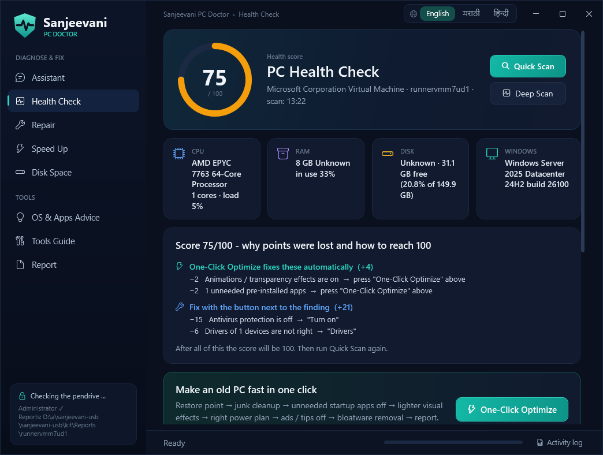
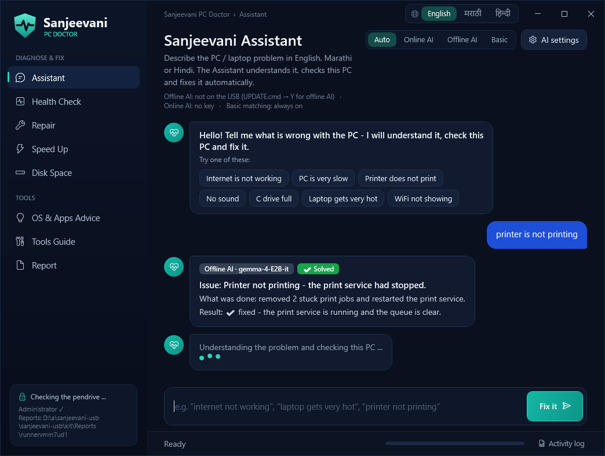

# Sanjeevani Rescue USB

*Created by **Mangesh Salvi***

**English** · [मराठी](README.mr.md) · [हिन्दी](README.hi.md)

A bootable technician pendrive to check, repair and speed up Windows PCs - built only from free and legal tools, on top of [Ventoy](https://www.ventoy.net). Everything a user sees is available in **English, Marathi and Hindi**.

| Health check | Assistant |
|---|---|
|  |  |

## Make the USB

1. Download this repository (**Code → Download ZIP**) or the `Sanjeevani-USB-Kit` artifact from Actions, and extract it.
2. Plug in a 64 GB pendrive (256 GB for the offline driver packs). **Everything on it is erased.**
3. Run `SETUP.cmd` → allow Administrator → choose the language → the pendrive's Disk number → `ERASE`.
4. Update later with `Sanjeevani\Setup\UPDATE.cmd` on the USB.
5. **Your own apps:** copy them to the USB's `MyTools` folder (a portable app folder, a single .exe, an installer, or a zip / 7z / rar). They appear in PC Doctor → Tools Guide → "My tools".
6. **Other OSes / boot tools:** copy any `.iso` (or `.wim`, `.img`, `.vhd`) into the `ISO` folder - it shows up in the boot menu by itself.
7. USB full? `CLEAN.cmd` lists duplicate driver packs, old versions and partial downloads, and moves them to `_to_delete` only after you agree. It never touches `Reports` or `Rescue` (customer data).

Full guide: [`kit/Sanjeevani/Docs/guide-en.html`](kit/Sanjeevani/Docs/guide-en.html) ([मराठी](kit/Sanjeevani/Docs/guide-mr.html), [हिन्दी](kit/Sanjeevani/Docs/guide-hi.html)) - Setup also copies it to the USB in the chosen language.

## Start PC Doctor without the USB

On any Windows 10 / 11 PC with internet, open **PowerShell as Administrator** and paste:

```powershell
irm https://raw.githubusercontent.com/Salvitalathi/sanjeevani-usb/main/run.ps1 | iex
```

It downloads the latest PC Doctor (about 2 MB) to `%LOCALAPPDATA%\Sanjeevani-Web` and starts it. Tools are fetched from their official sites when needed. Works only while this repository is public.

## What is on the USB

| Part | What it does |
|---|---|
| Boot menu | Hiren's BootCD PE, SystemRescue, MemTest86+/MemTest86, GParted, Clonezilla, Rescuezilla, Super Grub2, Boot-Repair, Kaspersky Rescue Disk, ShredOS, Windows 11, Linux Mint XFCE |
| PC Doctor (`START-Sanjeevani.cmd`) | Health check with a score (and why it is not 100), One-Click Optimize, DISM/SFC repair, registry check for virus changes, startup / bloatware / visual tweaks (all with Undo), moving files off a full C: drive, OS and app advice, HTML report |
| Assistant | Describe the problem in your own words - English, Marathi, Hindi or Roman script. After one consent it makes a restore point, **checks whether the problem really exists on this PC, fixes it, verifies, and tries the next likely cause** if needed, then says briefly what was wrong and what it did. Works offline with a local AI (Gemma 4 E2B via llama.cpp, optional 3.2 GB download), online with your own Gemini / Claude key, or with keyword matching. The AI never runs commands - it only picks from PC Doctor's tested checks and repairs. |
| Voice (Sanjeevani) | When PC Doctor opens, Sanjeevani greets you in a female voice and listens through the PC's microphone (turned on automatically if muted). Say the problem in Marathi, Hindi or English - she replies in the language you speak, checks and fixes while calm music plays, then tells you what was wrong and what she did. No microphone? Type it. Voices: Piper (offline, optional ~800 MB with whisper.cpp speech recognition) or Windows' own voices; listening also works online with your Gemini key. Turn off "Start when PC Doctor opens" on the voice screen to stop the auto-start. |
| Tools Guide | 60+ tools (HWiNFO, CPU-Z, CrystalDiskInfo, Prime95, BlueScreenView, MSERT, WizTree, ProduKey, SDIO, RustDesk ...) explained with warnings; 11 automatic checks run the tool and explain the result. |
| Rescue | When Windows will not start: Hiren's PE → `PCDoctor-Rescue.cmd` (drivers, blue-screen cause, stuck updates, SFC/DISM offline, boot repair, saving data). |
| Protection | Write-protect switch support and a SHA-256 integrity check of the USB against viruses on customers' PCs. |

## Repository

```
SETUP.cmd, Setup-Sanjeevani.ps1   make / update the USB, link check (-ResolveOnly)
CLEAN.cmd, Clean-Sanjeevani.ps1   free space on a full USB safely
kit/                              everything copied to the pendrive
  ventoy/theme/sanjeevani/        boot menu theme (build/make_theme.py)
  Sanjeevani/PCDoctor/            PC Doctor (PowerShell 5.1 + WPF), lib/*.psm1, data/*.json, assets/
  Sanjeevani/Docs/                guides (build/make_guides.py), test pages
  Sanjeevani/tools.json           tool list and download sources
tests/                            Windows tests (GitHub Actions)
build/                            generators (theme, icon, guides, problem catalog, tools guide), package.py
```

## Development

- `.ps1`/`.psm1` must be **UTF-8 with BOM** (Windows PowerShell 5.1 misreads Marathi / Hindi otherwise); `.cmd` files CRLF. Tests check both.
- User-facing text uses `L 'English' 'मराठी' 'हिन्दी'`; window labels live in the `$UiText` table of `PCDoctor.ps1`. A test fails if any language is missing.
- Every push runs the tests on Windows Server: parsing, encoding, PC Doctor self-test in all three languages, undo, safe file moves, real scans and repairs. `ui.yml` renders every page to PNG (`ui-shots` branch), `ai.yml` measures the offline AI, `links.yml` checks download links weekly.
