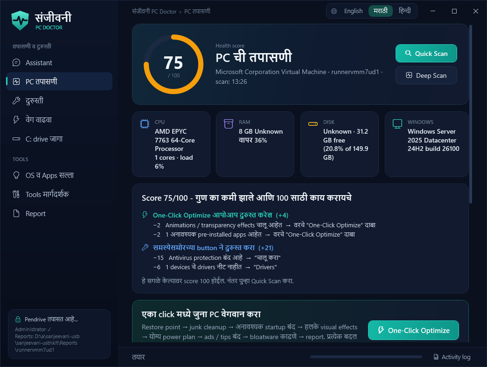

# संजीवनी Rescue USB

[English](README.md) · **मराठी** · [हिन्दी](README.hi.md)

PC तपासणी, दुरुस्ती आणि वेग वाढवण्यासाठी bootable pendrive. यात फक्त free आणि legal tools वापरले आहेत. Pendrive [Ventoy](https://www.ventoy.net) वर आधारित आहे.



## वापर

1. हे repository download करा (**Code → Download ZIP**) किंवा Actions मधून `Sanjeevani-USB-Kit` artifact घ्या, आणि extract करा.
2. 64 GB pendrive लावा (offline driver packs हवे असतील तर 256 GB). **त्यातला सगळा data पुसला जाईल.**
3. `SETUP.cmd` → Administrator परवानगी → भाषा निवडा → pendrive चा Disk number → `ERASE`.
4. नंतर update करण्यासाठी pendrive वरील `Sanjeevani\Setup\UPDATE.cmd` चालवा.
5. **स्वतःचे apps जोडायचे असल्यास** ते pendrive वरच्या `MyTools` folder मध्ये copy करा. Portable app चा पूर्ण folder चालतो, तसंच एकटी .exe, installer किंवा zip / 7z / rar पण. Zip UPDATE.cmd आपोआप extract करतो, किंवा PC Doctor मध्ये "Extract करा" दाबा. ते PC Doctor → Tools मार्गदर्शक → "माझे tools" मध्ये दिसतील. पहिल्यांदा virus तपासणी "हे तुम्ही टाकले का?" असं विचारेल, तेव्हा हो म्हणा.
6. **दुसरे OS / boot tools जोडायचे असल्यास** `.iso` (किंवा `.wim`, `.img`, `.vhd`) फाईल pendrive च्या `ISO` folder मध्ये copy करा. ती boot menu मध्ये आपोआप दिसते. उदा. Windows 10, Ubuntu, Tails. 4 GB पेक्षा मोठी ISO पण चालते.
7. Pendrive भरला असेल तर `CLEAN.cmd` चालवा. तो duplicate driver packs, जुनी versions आणि अर्धवट downloads शोधतो. आधी यादी दाखवतो आणि Y दिल्यावरच त्या फाईली `_to_delete` मध्ये हलवतो. `Reports` आणि `Rescue` (ग्राहकांचा data) ला तो कधीच हात लावत नाही.

पूर्ण मार्गदर्शक: [`kit/Sanjeevani/Docs/guide-mr.html`](kit/Sanjeevani/Docs/guide-mr.html) - Setup निवडलेल्या भाषेतले मार्गदर्शक pendrive वर पण ठेवतो.

## Pendrive वर काय असते

| भाग | माहिती |
|---|---|
| Boot menu | Hiren's BootCD PE, SystemRescue, MemTest86+/MemTest86, GParted, Clonezilla, Rescuezilla, Super Grub2, Boot-Repair, Kaspersky Rescue Disk, ShredOS, Windows 11, Linux Mint XFCE |
| PC Doctor (`START-Sanjeevani.cmd`) | Scan आणि health score, One-Click Optimize, DISM/SFC repair, startup/bloatware/visual tweaks (सगळ्यांना Undo), C: drive वरचे files दुसऱ्या drive वर हलवणे, OS आणि apps सल्ला, HTML report |
| Offline repair | Hiren's PE मधून `Sanjeevani\PCDoctor\Offline-Repair.cmd` चालवा: offline SFC/DISM, bcdboot, अडकलेले updates revert करणे |
| Assistant (PC Doctor मध्ये) | समस्या स्वतःच्या शब्दांत लिहा - मराठी, हिंदी, English किंवा Roman (उदा. "net chalat nahi", "laptop खूप गरम होतो"). एकदा परवानगी दिल्यावर restore point बनवून तो **समस्या या PC वर खरंच आहे का ते तपासतो, दुरुस्त करतो, पुन्हा तपासतो** आणि गरज असल्यास पुढचे संभाव्य कारण तपासतो; शेवटी थोडक्यात सांगतो काय होते आणि काय केले. Offline AI (Gemma, pendrive वर), तुमच्या key ने online AI, किंवा keywords. AI स्वतः काहीही चालवत नाही. |
| आवाज (संजीवनी) | PC Doctor उघडताच संजीवनी स्त्री आवाजात स्वागत करते आणि PC च्या mic मधून ऐकते (mic बंद / mute असेल तर आपोआप चालू). समस्या मराठी, हिंदी किंवा English मध्ये बोला - तुम्ही ज्या भाषेत बोलाल त्याच भाषेत ती उत्तर देते, शांत music सुरू असताना तपासते आणि दुरुस्त करते, आणि शेवटी काय समस्या होती व काय केले ते सांगते. Mic नसेल तर लिहून सांगा. आवाज: Piper (offline, optional ~800 MB, whisper.cpp सह) किंवा Windows चे आवाज; Gemini key असल्यास online ऐकणे. आपोआप सुरू नको असेल तर voice screen वर "PC Doctor उघडताच सुरू करा" काढा. |
| Tools मार्गदर्शक (PC Doctor मध्ये) | HWiNFO, CPU-Z, CrystalDiskInfo, Prime95, BlueScreenView, MSERT, WizTree, ProduKey, SDIO, RustDesk आणि इतर 60+ tools. प्रत्येक tool चं English / मराठी / हिन्दी स्पष्टीकरण आणि इशारे. 11 तपासण्या tool स्वतः चालवून निकाल सोप्या भाषेत सांगतात. Pendrive वरचे `Tools` / `Installers` folders लपवलेले असतात. |

## Repository रचना

```
SETUP.cmd, Setup-Sanjeevani.ps1   USB बनवणे / update / link check (-ResolveOnly)
kit/                              pendrive वर copy होणारे सर्व
  ventoy/theme/sanjeevani/        boot menu theme (build/make_theme.py ने बनवलेले)
  Sanjeevani/PCDoctor/            PC Doctor (PowerShell 5.1 + WPF), lib/*.psm1, data/*.json
  Sanjeevani/tools.json           tools ची यादी आणि download sources
tests/Run-Tests.ps1               Windows वर चालणारे tests (GitHub Actions)
build/                            theme / font generator, package.py, pscheck.py
```

## Development

- `.ps1`/`.psm1` files **UTF-8 with BOM** मध्येच ठेवा. BOM नसेल तर Windows PowerShell 5.1 मराठी / हिंदी मजकूर चुकीचा वाचतो आणि script चालत नाही. `.cmd` files CRLF मध्ये ठेवा. दोन्ही गोष्टी tests तपासतात.
- प्रत्येक push वर Windows Server वर tests चालतात: parsing, encoding, XAML, undo, सुरक्षित file move, आणि खऱ्या Windows वर scan.
- Download links दर आठवड्याला आपोआप तपासले जातात (`links.yml`).
